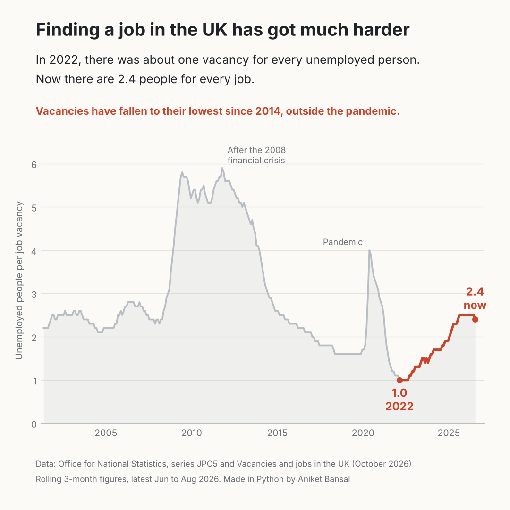

# 🇬🇧 The UK jobs squeeze

**Unemployment looks stable, so why is finding a job so hard?**

The headline UK unemployment rate (4.7% in June to August 2026) looks fairly ordinary by historical standards. But the number that matters to someone looking for work is how many people are competing for each job. That number has more than doubled in four years.



---

## 🔍 Key findings

| | Unemployed people per vacancy | Period |
|---|---|---|
| Post-pandemic low | **1.0** | Jan to Mar 2022 |
| Recent high | **2.5** | Jul to Sep 2025 through May to Jul 2026 |
| Latest | **2.4** | Jun to Aug 2026 |

- **Competition for each job has risen about 2.4 times since 2022.** In early 2022 there was roughly one vacancy for every unemployed person. Now there are 2.4 people for every job.
- **Vacancies are at a 12-year low.** There were 691,000 vacancies in July to September 2026, the lowest outside the pandemic since July to September 2014 (686,000), and down 5.1% on the year.
- **The squeeze is uneven.** Construction saw the largest quarterly fall in vacancies (down 20.5%). Over the year, professional, scientific and technical activities had the largest fall in volume (down 9,000, or 11.6%).
- **Context matters.** Today's ratio is far below the peak after the 2008 financial crisis (5.9 in late 2011), but it has been rising steadily for four years, which is why the market feels so much tougher than the unemployment rate suggests.

---

## ❓ The question

> Does the headline unemployment rate tell job seekers what the market actually feels like?

The unemployment rate counts people out of work. It says nothing about how many jobs are available to them. The **unemployed-per-vacancy ratio** combines both sides of the market, so it is a better measure of how hard it is to find work.

---

## 📁 Project structure

```
├── data/
│   ├── unemployed_per_vacancy_jpc5.csv       # ONS series JPC5, monthly (rolling 3-month)
│   └── unemployment_rate_mgsx_quarterly.csv  # ONS series MGSX, quarterly
├── src/
│   └── make_chart.py                         # Builds the chart from the CSV
├── charts/
│   └── unemployed_per_vacancy.png
└── README.md
```

## 🚀 How to run

```bash
pip install pandas matplotlib
python src/make_chart.py
```

The script prints the key figures (post-pandemic low, latest value and series peak) and saves the chart to `charts/`.

---

## 📊 Data and method

- **Unemployed people per vacancy:** ONS series [JPC5](https://www.ons.gov.uk/employmentandlabourmarket/peoplenotinwork/unemployment/timeseries/jpc5/unem), UK excluding agriculture, forestry and fishing, released 20 October 2026. Values are rolling 3-month averages. ONS labels each value by the middle month, so "2026 JUL" means June to August 2026.
- **Unemployment rate:** ONS series [MGSX](https://www.ons.gov.uk/employmentandlabourmarket/peoplenotinwork/unemployment/timeseries/mgsx/lms), aged 16 and over, seasonally adjusted.
- **Vacancy levels and industry breakdown:** ONS, [Vacancies and jobs in the UK: October 2026](https://www.ons.gov.uk/employmentandlabourmarket/peopleinwork/employmentandemployeetypes/bulletins/jobsandvacanciesintheuk/october2026).

**Limitations:** ONS publishes the ratio to one decimal place, so small changes are hidden. Labour Force Survey estimates carry sampling uncertainty, and the latest vacancy figure is an early estimate. Unemployed people are not all competing for the same jobs, so the ratio is a market-wide signal rather than the odds for any one person.

---

## 🔜 Next steps

- Break the ratio down by region (including Scotland) and by age group.
- Add online job advert data to see which skills are still in demand.

---

## 👤 Author

**Aniket Bansal**, Data Analyst
[LinkedIn](https://www.linkedin.com/in/ianiketx) | [Portfolio](https://aniket-portfolio-nz7f.vercel.app/portfolio.html)
