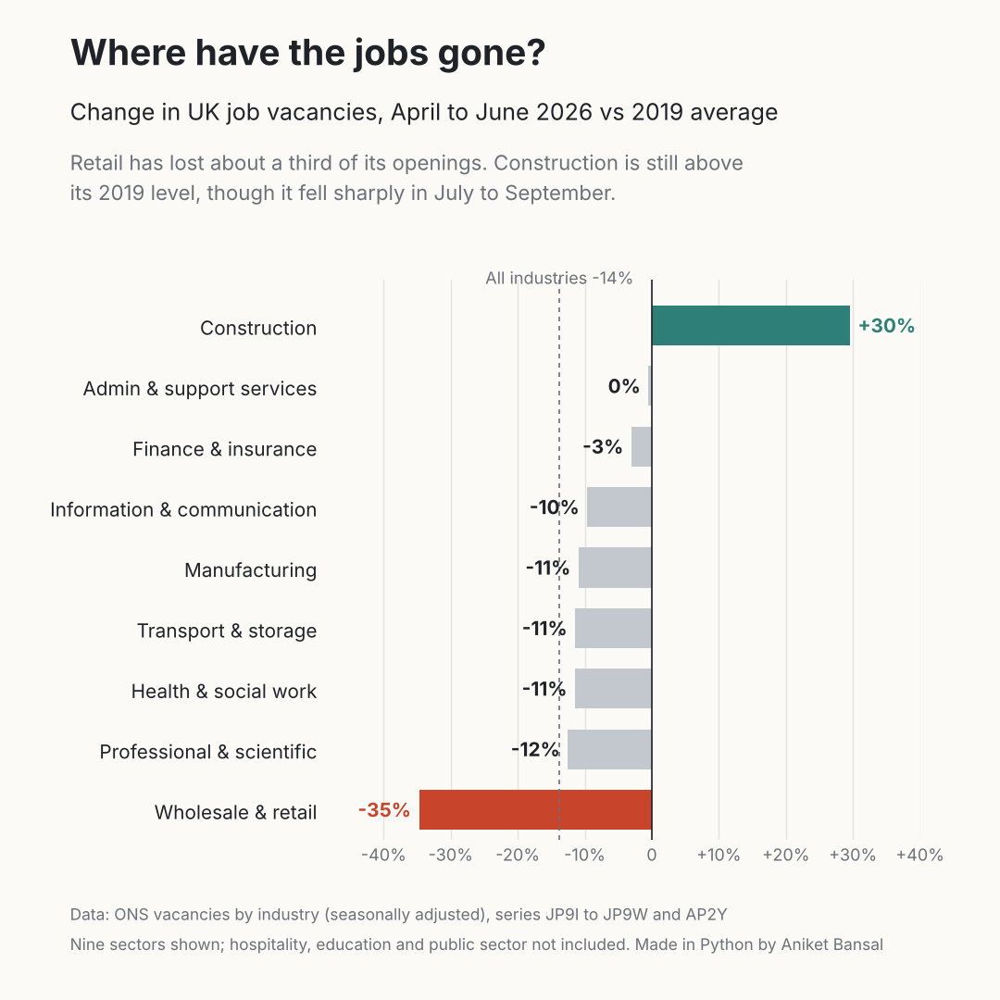

# 🇬🇧 The UK jobs squeeze

**Unemployment looks stable, so why is finding a job so hard?**

The headline UK unemployment rate (4.7% in June to August 2026) looks fairly ordinary by historical standards. But the number that matters to someone looking for work is how many people are competing for each job. That number has more than doubled in four years.


---

## 🔍 Key findings

| | Unemployed people per vacancy | Period |
|---|---|---|
| Post-pandemic low | **1.0** | Jan to Mar 2022 |
| Recent high | **2.5** | Jul to Sep 2025 through May to Jul 2026 |
| Latest | **2.4** | Jun to Aug 2026 |

- **Competition for each job has risen about 2.4 times since 2022.** In early 2022 there was roughly one vacancy for every unemployed person. Now there are 2.4 people for every job.
- **Vacancies are at a 12-year low.** There were 691,000 vacancies in July to September 2026, the lowest outside the pandemic since July to September 2014 (686,000), and down 5.1% on the year.
- **The squeeze is uneven.** Construction saw the largest quarterly fall in vacancies (down 20.5%). Over the year, professional, scientific and technical activities had the largest fall in volume (down 9,000, or 11.6%).
- **Context matters.** Today's ratio is far below the peak after the 2008 financial crisis (5.9 in late 2011), but it has been rising steadily for four years, which is why the market feels so much tougher than the unemployment rate suggests.

---

## 🏭 Sector by sector: where have the jobs gone?



Comparing vacancies in April to June 2026 with the 2019 average (before the pandemic):

| Industry | 2019 average (000s) | Apr to Jun 2026 (000s) | vs 2019 | vs Apr to Jun 2022 |
|---|---|---|---|---|
| Construction | 26.2 | 34 | **+30%** | -33% |
| Admin & support services | 52.2 | 52 | 0% | -36% |
| Finance & insurance | 33.0 | 32 | -3% | -43% |
| Information & communication | 44.2 | 40 | -10% | -49% |
| Manufacturing | 55.0 | 49 | -11% | -47% |
| Transport & storage | 37.2 | 33 | -11% | -38% |
| Health & social work | 137.8 | 122 | -11% | -42% |
| Professional & scientific | 80.0 | 70 | -12% | -47% |
| Wholesale & retail | 133.2 | 87 | **-35%** | -48% |
| **All industries** | **824.5** | **711** | **-14%** | **-45%** |

- **Hardest hit: wholesale and retail**, with about a third fewer openings than before the pandemic. It is also one of the biggest employers, so this affects a lot of people.
- **Least affected: construction**, still about 30% above its 2019 level in April to June 2026. However, construction vacancies then fell 20.5% in July to September, the biggest quarterly fall of any industry, so this lead may not last.
- **Every sector is down sharply on the 2022 peak**, by between a third and a half. The 2022 hiring boom was the exception, and the market has now dropped below where it was before the pandemic.
- **Analyst-heavy sectors** (information and communication; professional, scientific and technical) are 10 to 12% below 2019, close to the average.

**Why compare with 2019?** It is the last normal year before the pandemic. Comparing only with 2022 would exaggerate the decline, because 2022 was an unusual hiring boom.

**Not included:** accommodation and food, education, public administration, real estate, arts and other services. Their series could not be retrieved for this version; they will be added in a later update. Some sector pages were on the 15 September 2026 release and others on 20 October 2026, so April to June 2026 is used as the common latest quarter.

---

## ❓ The question

> Does the headline unemployment rate tell job seekers what the market actually feels like?

The unemployment rate counts people out of work. It says nothing about how many jobs are available to them. The **unemployed-per-vacancy ratio** combines both sides of the market, so it is a better measure of how hard it is to find work.

---

## 📁 Project structure

```
├── data/
│   ├── unemployed_per_vacancy_jpc5.csv       # ONS series JPC5, monthly (rolling 3-month)
│   ├── unemployment_rate_mgsx_quarterly.csv  # ONS series MGSX, quarterly
│   └── vacancies_by_industry.csv             # ONS vacancies by industry (JP9I to JP9W, AP2Y)
├── src/
│   ├── make_chart.py                         # Unemployed-per-vacancy chart
│   └── make_industry_chart.py                # Sector comparison chart
├── charts/
│   ├── unemployed_per_vacancy.png
│   └── vacancies_by_industry.png
└── README.md
```

## 🚀 How to run

```bash
pip install pandas matplotlib
python src/make_chart.py
python src/make_industry_chart.py
```

Each script prints the key figures (post-pandemic low, latest value and series peak) and saves the chart to `charts/`.

---

## 📊 Data and method

- **Unemployed people per vacancy:** ONS series [JPC5](https://www.ons.gov.uk/employmentandlabourmarket/peoplenotinwork/unemployment/timeseries/jpc5/unem), UK excluding agriculture, forestry and fishing, released 20 October 2026. Values are rolling 3-month averages. ONS labels each value by the middle month, so "2026 JUL" means June to August 2026.
- **Unemployment rate:** ONS series [MGSX](https://www.ons.gov.uk/employmentandlabourmarket/peoplenotinwork/unemployment/timeseries/mgsx/lms), aged 16 and over, seasonally adjusted.
- **Vacancies by industry:** ONS time series JP9I (manufacturing), JP9L (construction), JP9M (wholesale and retail), JP9N (transport and storage), JP9P (information and communication), JP9Q (finance and insurance), JP9S (professional, scientific and technical), JP9T (administrative and support) and JP9W (health and social work), plus AP2Y (total). Seasonally adjusted, thousands. Change is calculated as April to June 2026 divided by the 2019 quarterly average, minus one.
- **Vacancy levels and industry commentary:** ONS, [Vacancies and jobs in the UK: October 2026](https://www.ons.gov.uk/employmentandlabourmarket/peopleinwork/employmentandemployeetypes/bulletins/jobsandvacanciesintheuk/october2026).

**Limitations:** ONS publishes the ratio to one decimal place, so small changes are hidden. Labour Force Survey estimates carry sampling uncertainty, and the latest vacancy figure is an early estimate. Unemployed people are not all competing for the same jobs, so the ratio is a market-wide signal rather than the odds for any one person.

---

## 🔜 Next steps

- Add the missing sectors (hospitality, education, public sector).
- Break the ratio down by region (including Scotland) and by age group.
- Add online job advert data to see which skills are still in demand.

---

## 👤 Author

**Aniket Bansal**, Data Analyst
[LinkedIn](https://www.linkedin.com/in/ianiketx) | [Portfolio](https://aniket-portfolio-nz7f.vercel.app/portfolio.html)
